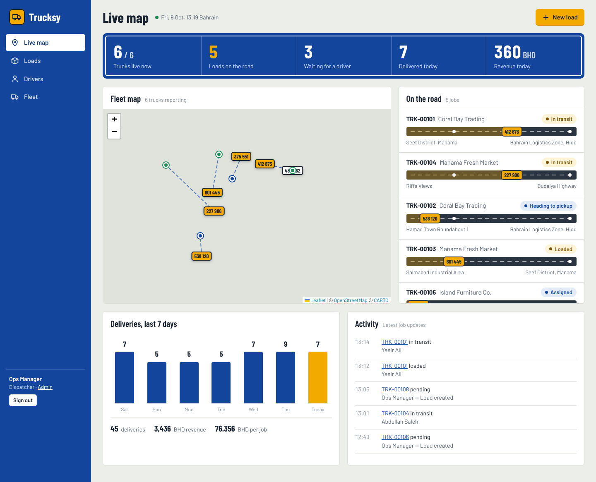

# Trucksy v2

Trucking dispatch platform for Bahrain and the GCC, in three parts:

| Part | Who uses it | Tech | Folder |
|---|---|---|---|
| **Dispatch console** | Office / ops team | Django templates + vanilla JS + Leaflet map | `backend/templates`, `backend/static` |
| **API + database** | Everything talks to it | Django 5.2, Django REST Framework, Postgres (SQLite locally) | `backend/` |
| **Trucksy Driver app** | Drivers (Android / iOS) | Expo SDK 54, React Native, Expo Router | `driver-app/` |
| **Customer tracking page** | Your customers (no login) | `/t/<code>/`, shared by link or WhatsApp | `backend/templates/dashboard/track.html` |



---

## Run it on your laptop (10 minutes)

You need **Python 3.12+** and **Node 20+**.

### 1. Backend + dashboard

```bash
cd backend
python -m venv .venv
# Windows:  .venv\Scripts\activate      Mac/Linux:  source .venv/bin/activate
pip install -r requirements.txt
copy .env.example .env          # Mac/Linux: cp .env.example .env
python manage.py migrate
python manage.py seed_demo      # demo trucks, drivers and loads around Bahrain
python manage.py runserver 0.0.0.0:8000
```

Open **http://localhost:8000** and sign in with `admin` / `trucksy123`.

To make the trucks move on the map during a demo, open a second terminal and run:

```bash
python manage.py simulate_drivers
```

Run the tests with `python manage.py test`. All 8 should pass.

### 2. Driver app

```bash
cd driver-app
npm install
npx expo start
```

* **Quickest test:** press `w` to open the app in your browser.
* **On your phone:** the app uses background location, which Expo Go doesn't support. Build a development app once with `npx eas-cli build -p android --profile development`, install it, then run `npx expo start --dev-client`.
* On the login screen, tap **Server settings** and enter your laptop's Wi-Fi address, for example `http://192.168.1.10:8000`. Find it with `ipconfig` (Windows) or `ifconfig` (Mac).

Demo driver login: phone **34180130**, PIN **1234** (Yasir Ali).

---

## How a job flows

```
Dispatcher creates load ─► assigns driver ─► driver app shows "Your job"
      │                                              │
      │        Start driving ─► Goods loaded ─► Leave for drop-off ─► Mark as delivered (receiver name)
      │                                              │
      └── live map, road strip and activity log ◄────┘ GPS every 15 s or 50 m, including with the screen off
                     │
                     └─► customer tracking link (/t/<code>/) and WhatsApp share
```

## API summary

| Endpoint | Who | What it does |
|---|---|---|
| `POST /api/auth/driver/login/` | Driver | Phone and PIN in, token out |
| `GET /api/me/` | Driver | Profile, current job, today's stats |
| `POST /api/me/status/` | Driver | Go online, offline or on break |
| `POST /api/me/location/` | Driver | Send one GPS point, or a batch with `{"points":[...]}` |
| `GET /api/me/loads/` | Driver | Active jobs and history |
| `POST /api/me/loads/<id>/advance/` | Driver | Move a job to its next step (steps can't be skipped) |
| `GET /api/dashboard/` | Dispatcher | KPIs, live drivers, active loads, activity feed |
| `/api/loads/`, `/api/drivers/`, `/api/trucks/` | Dispatcher | Create, read, update and delete |
| `POST /api/loads/<id>/set_status/` | Dispatcher | Manual override, such as cancelling a load |
| `GET /api/public/track/<code>/` | Anyone | Customer-safe tracking data (no prices) |
| `GET /api/health/` | Anyone | Uptime check |

Drivers authenticate with `Authorization: Token <token>`. Dispatchers are Django **staff** users; create one with `python manage.py createsuperuser`.

## What changed from v1

* **The source code was missing from the archive.** v2 is a clean rebuild based on the v1 database schema and the decompiled v1 APK.
* The API address no longer points at a temporary ngrok URL. It's set at build time in `eas.json`, and can be overridden from the login screen.
* Fixed the field mismatch that broke driver registration (`cpr`/`license_number` vs `truck_id`).
* Merged the two location tables and the two sensor tables into one `LocationPing` and one `SensorReading`.
* Added real login (phone + PIN, then a token). Drivers can only see and update their own jobs.
* Added background GPS with an Android foreground notification, plus an offline queue for points sent without signal.
* Added the job lifecycle with an audit trail, proof of delivery and a public tracking page.
* Removed the Expo template leftovers and the placeholder package name. The app ID is now `com.trucksy.driver`.
* Production-ready settings: environment variables, Postgres, WhiteNoise, HTTPS, Render blueprint.

See **LAUNCH_GUIDE.md** for the step-by-step path to going live.

---

## Legacy v1

The original v1 code (`transprot_app`, May 2026) is preserved unchanged in [`legacy/v1/`](legacy/v1/) for reference. It is not used by v2.
